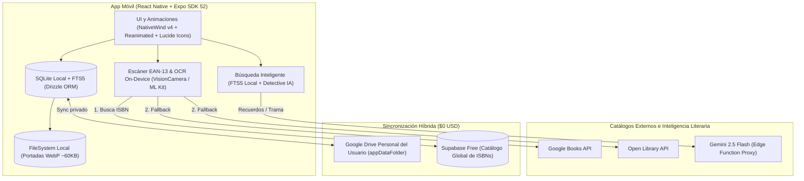

# BaciBooks 📚

> **Tu biblioteca física y digital unificada, con portadas reales, motor de lectura inteligente y arquitectura Local-First.**

[](https://reactnative.dev/)
[](https://expo.dev/)
[](https://www.typescriptlang.org/)
[](https://orm.drizzle.team/)
[](https://www.nativewind.dev/)
[](https://lucide.dev/)
[](LICENSE)

---

## 📖 Visión General

**BaciBooks** es una aplicación móvil multiplataforma (*Android e iOS*) diseñada para resolver la mayor frustración de los lectores al digitalizar su biblioteca personal: **registrar la edición exacta que tienen en sus manos (con su editorial y portada real)** en segundos, ya sean libros físicos o libros digitales (*eBooks*).

Construida bajo una filosofía **Local-First**, la aplicación funciona **al 100% sin conexión a internet** dentro de librerías, ferias del libro o en modo avión, y sincroniza de forma segura y privada los respaldos del lector con su propia nube personal a **costo `$0 USD`**.

---

## ✨ Características Principales

- 📸 **Escáner ISBN con Selector Visual de Edición:** Escaneo `EAN-13` a 60 fps (Individual y **Modo Ráfaga** para repisas completas), carrusel de portadas alternativas, chips de editoriales en español y cámara con recorte y compresión automática a formato `WebP` (`~50-80 KB`).
- 📖📱 **Soporte Dual Nativo:** Libros físicos (formato, ubicación en librero/repisa y préstamos) y digitales (Kindle, Kobo, Apple Books, EPUB/PDF, avance por páginas o por porcentaje `0% - 100%`).
- 🗂️ **Agrupación Visual por Sagas:** Orden numérico de lectura (`#1`, `#1.5`, `#2`), barra de progreso de la saga y control inteligente de orden de lectura.
- ⏱️ **Cronómetro Resiliente:** Persistencia en SQLite basada en timestamps de época (`started_at_epoch_ms`), inmune al bloqueo de pantalla o ahorro de batería del celular.
- 🔮 **Motor de Predicciones y Metas:** Proyección matemática de finalización por libro activo (*"Terminarás este libro el jueves 14"*), cálculo de ritmo (`págs/hora`, `págs/día`) y proyecciones de metas mensuales/anuales.
- 🔍 **Búsqueda Inteligente / Detective Literario:** Búsqueda FTS5 offline en la biblioteca local y búsqueda semántica con **Gemini 2.5 Flash** para encontrar libros por recuerdos de trama, personajes o citas aproximadas sin recordar el título.
- 🖍️ **Marcatextos Digital OCR:** Extracción de texto on-device (*Google ML Kit* a costo `$0 USD`) para digitalizar citas literarias y generar postales compartibles.
- 🤝 **Control de Préstamos Bidireccional:** Registro de libros que prestaste (`LENT_OUT`) y libros que te prestaron a ti o de biblioteca (`BORROWED_IN`) con recordatorios locales.

---

## 🏗️ Arquitectura del Sistema (Local-First Híbrida)



La estructura del código sigue el estándar **Feature-Sliced Design**:
```text
BaciBooks/
├── app/                  # Rutas de Expo Router (Solo navegación y layouts)
├── src/
│   ├── core/             # Configuración transversal, tema y errores de dominio
│   ├── db/               # Capa Local-First (expo-sqlite, Drizzle ORM, schema y FTS5)
│   ├── features/         # Módulos de negocio independientes (catalog, scanner, shelves, etc.)
│   └── shared/           # Componentes UI reutilizables (SafeButton anti-doble toque, etc.)
├── assets/               # Iconos adaptativos y tipografía
├── docs/                 # Documentación legal y guías de arquitectura
└── tests/                # Pruebas unitarias (Jest) y pruebas de contratos de API (Zod)
```

---

## 🗺️ Roadmap por Fases

- [x] **Fase 0:** Arquitectura, prototipo interactivo de pantallas y auditoría técnica 360° ([AGENTS.md](AGENTS.md)).
- [ ] **Fase 1 (`v0.1.0`):** Cimientos de ingeniería, SQLite + Drizzle, Escáner ISBN exacto (Individual y Ráfaga), y estantería de libros físicos y digitales.
- [ ] **Fase 2 (`v0.2.0`):** Ciclo completo de estados de lectura, organización por ubicación física, Sagas y Ruleta TBR.
- [ ] **Fase 3 (`v0.3.0`):** Cronómetro por timestamps, metas mensual/anual y motor de predicciones de lectura.
- [ ] **Fase 4 (`v0.4.0`):** Búsqueda Inteligente con IA (Gemini), escáner OCR de citas y control de préstamos.
- [ ] **Fase 5 (`v1.0.0`):** Sincronización híbrida (Google Drive + Supabase) y despliegue en Google Play Store / App Store.

---

## 🚀 Inicio Rápido en Desarrollo

### Prerrequisitos
- **Node.js:** `>= 20.x`
- **npm** o **bun / pnpm**
- **Expo Go** (instalado en tu dispositivo Android o iOS) o emulador local

### Instalación
```bash
# Clonar el repositorio
git clone https://github.com/tu-usuario/BaciBooks.git
cd BaciBooks

# Instalar dependencias
npm install

# Copiar variables de entorno
cp .env.example .env

# Iniciar servidor de desarrollo
npx expo start
```

Escanea el código QR desde la app **Expo Go** en tu dispositivo físico para ver la app en tiempo real.

---

## 🛡️ Estándares de Ingeniería

El proyecto se rige por [AGENTS.md](AGENTS.md), asegurando:
- **TypeScript Estricto (`strict: true`)** y validación en tiempo de ejecución con **Zod**.
- **Protección Anti-Doble Toque (`SafeButton` / `useSafePress`)** en toda acción crítica.
- **Flujo de Git:** Integración continua sobre `develop`, releases etiquetados en `main` y **Conventional Commits en español**.
- **Pruebas Automatizadas:** Cobertura de cálculos matemáticos, checksums ISBN y mocks de APIs con Jest.

---

## ⚖️ Licencia y Términos

Distribuido bajo licencia MIT. Consulta [LEGAL_TERMINOS_Y_PRIVACIDAD.md](docs/LEGAL_TERMINOS_Y_PRIVACIDAD.md) para conocer las políticas de privacidad y términos de uso de la aplicación.
