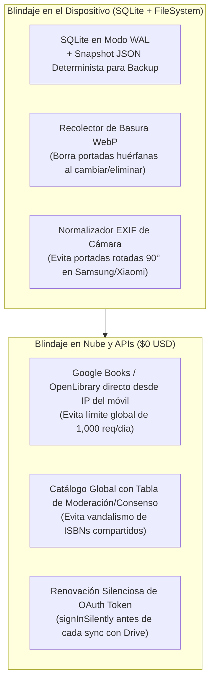

# Auditoría Profunda de Huecos Técnicos y de Usuario Final — **BaciBooks** 🛡️🔍

Este documento recoge el análisis exhaustivo de **15 huecos críticos** (8 de experiencia de usuario final para lectores reales y 7 de arquitectura e ingeniería móvil) detectados antes de escribir la primera línea de código, junto con la solución exacta que implementaremos en **BaciBooks**.

---

## Parte 1: Huecos de Funcionalidad de Usuario Final (Vida Real del Lector)

### 1. Escaneo de ISBN "Sin Señal" (*Cola Offline / Modo Feria del Libro*)
- **El hueco:** ¿Qué pasa si el usuario está en el sótano de una librería, en una Feria del Libro con la red celular colapsada o en casa sin Wi-Fi y quiere escanear 15 libros en **Modo Ráfaga**? Si el escáner depende al 100% de que Google Books responda en ese segundo, no podrá registrar nada.
- **Solución implementada en el diseño:**
  - Si no hay internet (o la petición tarda `> 2.5s`), el escáner **guarda inmediatamente el libro en SQLite con estado `metadata_status = 'PENDING_SYNC'`**, conservando el código `ISBN-13`, la ubicación física/Wishlist elegida y (opcionalmente) la foto de la portada tomada con la cámara.
  - En cuanto el teléfono detecta conexión nuevamente, un proceso ligero en segundo plano completa automáticamente el título, autor, páginas y sinopsis sin que el usuario pierda ningún escaneo.

### 2. Glosario de Personajes "Libre de Spoilers" por Libro
- **El hueco:** Al leer novelas con decenas de personajes (*Cien años de soledad*, *Dune*, *Juego de Tronos*, literatura rusa) o retomar un libro pausado, el lector olvida quién era un personaje secundario. Si lo busca en Google o en una Wiki, **se arruina la historia con spoilers de quién muere o quién es el traidor**.
- **Solución implementada en el diseño:**
  - En la tabla `BOOK_QUOTES` (ahora enriquecida con `entry_type: 'QUOTE' | 'CHARACTER' | 'NOTE'`), el usuario tendrá una pestaña rápida de **"Personajes y Glosario"** dentro de cada libro para anotar en una línea quién es cada personaje según lo que sabe hasta su página actual, 100% libre de spoilers.

### 3. Préstamos a la Inversa: *"Libros que ME prestaron a mí o de Biblioteca Pública"* (`BORROWED_IN`)
- **El hueco:** Habíamos contemplado cuando **tú prestas** un libro tuyo a un amigo (`LENT_OUT`). Pero ¿qué pasa cuando un amigo **te presta un libro a ti** o sacas un libro de una biblioteca pública?
  - Si no lo distingues, aparece como si fuera parte permanente de tus libros propios en casa, y además no tienes alerta de cuándo debes devolverlo tú.
- **Solución implementada en el diseño:**
  - Campo `ownership: 'OWNED' | 'BORROWED' | 'WISHLIST'` en `BOOKS` y `loan_direction: 'LENT_OUT' | 'BORROWED_IN'` en `BOOK_LOANS`.
  - Un libro que te prestaron suma páginas y cuenta para tus metas mensuales/anuales y estadísticas, te envía notificación antes de la fecha en que prometiste devolverlo, y al devolverlo queda en tu historial de lectura sin inflar el inventario de libros físicos que tienes en tu estantería.

### 4. Registro Retroactivo ("Leí anoche pero me quedé dormido") y Escudo de Racha
- **El hueco:** La mayoría de los lectores leen en la cama antes de dormir; es común cerrar el libro físico a las 11:50 PM, quedarse dormido y acordarse a la mañana siguiente de anotar las páginas. Si el sistema solo permite registrar sesiones con la fecha `Hoy`, el lector **pierde su racha diaria injustamente** aunque sí leyó.
- **Solución implementada en el diseño:**
  - Selector rápido **"¿Cuándo leíste? [Hoy] [Ayer]"** al guardar un avance de páginas o sesión manual, asignando correctamente `local_date` al día anterior.
  - Además, **1 Escudo de Racha (*Streak Freeze*)** automático al cumplir la meta semanal de páginas para que un día de emergencia no destruya meses de motivación.

### 5. El Bug del Contador al "Releer un Libro" (`Re-reading State`)
- **El hueco:** Si un libro está en estado `LEIDO` y el usuario decide releerlo cambiando `current_status` a `LEYENDO`, una consulta ingenua que cuente `WHERE current_status = 'LEIDO'` **le restaría 1 libro leído a su biblioteca total**.
- **Solución implementada en el diseño:**
  - La condición de "Libro ya leído al menos una vez" se evalúa por la existencia de al menos un registro finalizado en `READING_LOGS` (`read_count >= 1`). Así, cuando relees un libro, aparece en tu carrusel de *"Leyendo actualmente (Relectura #2)"* sin desaparecer jamás de tus libros terminados.

### 6. Limpieza Automática de Guiones y Saltos de Línea en el OCR de Citas
- **El hueco:** En los libros físicos impresos, las palabras largas al final del renglón se cortan con guion (`"impres-\ncindible"`). Si el OCR copia el texto literal con esos guiones y saltos de renglón, el usuario tiene que borrar guiones a mano cada vez que escanea una cita.
- **Solución implementada en el diseño:**
  - Un sanitizador lingüístico post-OCR que une automáticamente palabras divididas por guion al final de línea (`/\-\s*\r?\n\s*/g` → `""`), normaliza espacios y deja el párrafo limpio para editar o convertir en postal.

### 7. Soporte para Antologías, Libros de Cuentos y Avance por Capítulos
- **El hueco:** En libros de cuentos (*Ficciones*, *Bestiario*), poemarios o mangas, o en eBooks donde no hay páginas fijas, el lector quiere anotar en qué **Capítulo o Cuento** va o a qué capítulo pertenece una cita.
- **Solución implementada en el diseño:**
  - Campo opcional `chapter_or_section` en `BOOK_QUOTES` y soporte para progreso por `PAGES`, `PERCENTAGE` o `CHAPTERS`.

### 8. Protección Visual Anti-Spoilers (`Spoiler Blur`) en Notas y Reseñas
- **El hueco:** Cuando el lector le muestra su celular a un amigo para enseñarle su biblioteca digitalizada, las notas de pausa o reseñas visibles en pantalla pueden revelar el final de un libro.
- **Solución implementada en el diseño:**
  - Switch `is_spoiler` en notas y reseñas que aplica un desenfoque visual (*blur*) que solo se revela al tocarlo.

---

## Parte 2: Huecos Técnicos, de Arquitectura, Base de Datos y Tiendas

### 9. Prevención de Corrupción de SQLite al Respaldar en Google Drive (*WAL Mode vs JSON Snapshot*)
- **El hueco técnico:** SQLite moderno usa modo `WAL` (*Write-Ahead Logging*), donde los últimos datos escritos viven temporalmente en un archivo separado `bacibooks.db-wal`. Si subes el archivo `bacibooks.db` crudo a Google Drive sin vaciar el WAL, **el backup sube incompleto o corrupto**.
- **Solución técnica:**
  - El respaldo hacia Google Drive (`appDataFolder`) no copiará el binario `.db` en caliente; generará una **instantánea transaccional en JSON comprimido (`bacibooks_backup.json.gz`)** acompañada del manifiesto `schemaVersion`. Es 100% inmune a corrupción binaria, pesa hasta 70% menos comprimido con GZIP y permite validar cada tabla con `Zod` al restaurar en Android o iOS.

### 10. Protección Anti-Vandalismo en el Catálogo Comunitario Global de ISBNs
- **El hueco técnico:** Si cualquier usuario pudiera hacer un `UPDATE` directo sobre la tabla global de ISBNs en Supabase, un solo usuario que suba una foto equivocada o cambie el título de un ISBN por broma dañaría la ficha para todos los demás lectores.
- **Solución técnica:**
  - En Supabase, la tabla maestra `global_isbn_catalog` será de **solo lectura para clientes** una vez que un ISBN esté marcado como `verified = true`.
  - Las correcciones de los usuarios se insertan en `isbn_contributions` y se aplican inmediatamente en el SQLite local del usuario que hizo el cambio; en el catálogo global solo se promueven cuando el ISBN no existía o cuando `>= 2` usuarios independientes coinciden en la misma editorial/portada (consenso automático).

### 11. Evasión del Límite Diario de 1,000 Peticiones de Google Books API (`Rate Limit 429`)
- **El hueco técnico:** Si todas las búsquedas de ISBN usaran una única API Key de servidor para Google Books, el límite gratuito de 1,000 consultas/día se agotaría con apenas 50 usuarios usando el Modo Ráfaga.
- **Solución técnica:**
  1. Primero se consulta nuestro **Catálogo Global en Supabase** (si el libro ya fue escaneado antes por cualquier lector de BaciBooks, responde en `20ms` y gasta **0 cuota** de Google Books).
  2. Si no está en nuestro catálogo, la petición pública a Google Books y Open Library sale **directamente desde la IP del teléfono del usuario**, distribuyendo el límite por cada usuario individual y nunca en un cuello de botella central.

### 12. Recolector de Basura para Imágenes `.webp` Huérfanas (*Storage Leak*)
- **El hueco técnico:** Si el usuario cambia la portada de un libro 4 veces o borra un libro de su biblioteca, borrar solo la fila en SQLite deja los archivos `.webp` antiguos ocupando espacio eternamente en `FileSystem.documentDirectory`.
- **Solución técnica:**
  - Los repositorios eliminarán el archivo físico anterior al actualizar o borrar un libro, y al iniciar la app una tarea ligera barrerá cualquier archivo en `/covers/` cuyo nombre no esté referenciado en `BOOKS.cover_uri`.

### 13. Rotación EXIF de Fotos de Cámara en Android (`Samsung / Xiaomi 90° Bug`)
- **El hueco técnico:** Muchos sensores de cámara en Android guardan la foto rotada `90°` y confían en un metadato `EXIF`. Si se recorta sin normalizar la orientación, la portada queda acostada horizontalmente.
- **Solución técnica:** Pasar siempre por el pipeline de `expo-image-manipulator` normalizando la orientación antes de aplicar el recorte `2:3` y la compresión `WebP`.

### 14. Renovación Silenciosa de Tokens OAuth de Google Drive (`401 Token Expired`)
- **El hueco técnico:** El `access_token` de Google dura solo 1 hora. Si el usuario intenta sincronizar al día siguiente sin refrescar el token, la subida falla con error `401`.
- **Solución técnica:** El servicio `GoogleDriveSyncService` invocará siempre `signInSilently()` / `getTokens()` antes de iniciar cualquier transferencia para obtener un token fresco de forma transparente para el usuario.

### 15. Escalado de Fuente del Sistema (`Accessibility Font Scaling`) y Teclado en Modales
- **El hueco técnico:** Si el usuario tiene configurada la letra grande en su celular (130%-150%), los badges de editorial y tarjetas con altura fija se rompen; y al editar notas en un Bottom Sheet, el teclado virtual puede tapar el botón de guardar.
- **Solución técnica:** Regla obligatoria en el Design System: cero alturas fijas en contenedores con texto, `maxFontSizeMultiplier={1.3}` en chips compactos y uso obligatorio de `KeyboardAvoidingView` en hojas modales.
