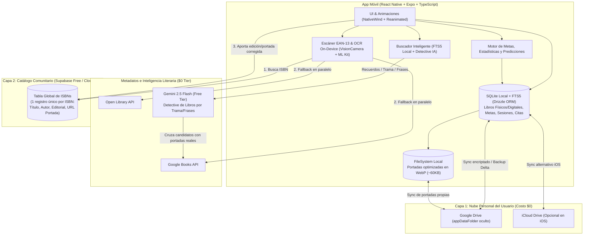
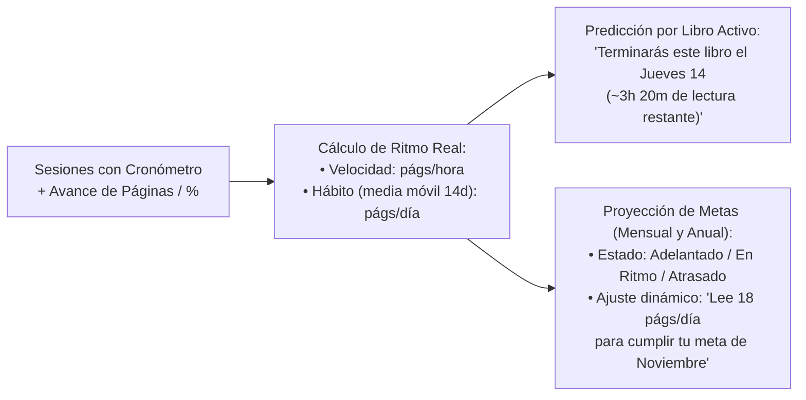
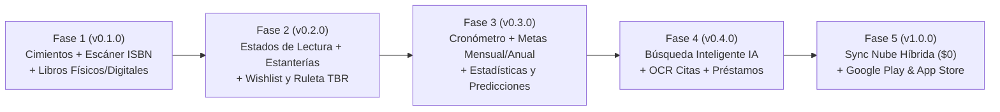
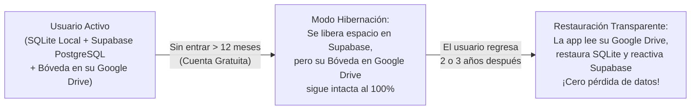

# Plan Maestro de Producto y Arquitectura: **BaciBooks** 📚

**BaciBooks** es una aplicación móvil (*Android y iOS*) diseñada bajo una filosofía **Local-First, Visual y Centrada en el Lector**. Su propósito es unificar en un solo lugar **tanto tu biblioteca física como tus libros digitales (eBooks)**, resolviendo el registro de la **edición exacta (ISBN + Editorial + Portada real)** y ofreciendo un motor inteligente de **metas, estadísticas, predicciones de lectura y búsqueda por recuerdos**.

El proyecto está regido por [AGENTS.md](file:///d:/Descargas/BaciBooks/AGENTS.md) para cumplir tres metas estratégicas:
1. **Uso personal piloto inmediato** (instalable en tu teléfono al cierre de cada fase).
2. **Proyecto insignia de portafolio en GitHub** (arquitectura *Feature-Sliced*, CI/CD, commits semánticos y entregas por fases etiquetadas con SemVer).
3. **Despliegue comercial escalonado:** primero en **Google Play Store** y posteriormente en **Apple App Store**.

---

## 1. Arquitectura Técnica y Sincronización Híbrida (`$0 USD`)

### Matriz Oficial del Stack Tecnológico

| Categoría | Tecnología / Paquete Oficial | Propósito en BaciBooks |
| :--- | :--- | :--- |
| **Framework & Lenguaje** | `Expo SDK 52+` + `React Native` + `TypeScript 5.x` (`strict: true`) | Base multiplataforma Android/iOS con Nueva Arquitectura y tipado estricto. |
| **Navegación** | `expo-router` (v4 con `typedRoutes: true`) | Enrutamiento basado en archivos dentro de `app/` y deep linking tipado. |
| **Estilos y UI** | `NativeWind v4` (Tailwind CSS) + `lucide-react-native` | Sistema de diseño consistente, soporte de temas y componentes limpios. |
| **Animaciones y Gestos** | `react-native-reanimated` + `react-native-gesture-handler` + `expo-haptics` | Transiciones fluidas a 60/120 fps, carruseles, ruleta TBR y vibración háptica. |
| **Listas e Imágenes** | `@shopify/flash-list` + `expo-image` | Renderizado virtualizado de estanterías grandes y caché en disco de portadas. |
| **BD Local (ORM)** | `expo-sqlite` + `drizzle-orm` + `drizzle-kit` (+ `SQLite FTS5`) | Persistencia *Local-First* tipada (reemplaza a Prisma en móvil con 0 binarios extra), migraciones SQL automáticas y búsqueda offline. |
| **Estado en Memoria** | `zustand` + `expo-secure-store` | Estado efímero de UI (cola del escáner en ráfaga, cronómetro activo) y almacenamiento seguro de tokens. |
| **Validación de Datos** | `zod` | Validación en tiempo de ejecución de todas las respuestas de APIs externas y esquemas de IA. |
| **Cámara y Portadas** | `expo-camera` + `expo-image-manipulator` + `expo-file-system` | Lectura EAN-13/ISBN a 60 fps y compresión de portadas fotografiadas a formato `WebP` (`~60-80 KB`). |
| **OCR On-Device** | `@react-native-ml-kit/text-recognition` | Extracción de texto de páginas físicas para citas (100% en el dispositivo, offline y costo `$0 USD`). |
| **IA & Búsqueda** | `@google/genai` (**Gemini 2.5 Flash**) + `Google Books API` + `Open Library API` | Detective literario por trama/frases con JSON estructurado y cascada de metadatos/portadas. |
| **Utilidades Nativas** | `expo-notifications` + `react-native-view-shot` + `expo-sharing` | Recordatorios locales de préstamos físicos y generación de postales compartibles (Citas / Wrapped). |
| **Nube Híbrida (`$0`)** | `Google Drive API v3 (appDataFolder)` + `@supabase/supabase-js` | Backup privado en el Google Drive del usuario + Catálogo Comunitario Global de ISBNs en Supabase Free. |
| **Testing & QA** | `jest` + `jest-expo` + `@testing-library/react-native` + `eslint` | Pruebas unitarias de dominio, pruebas de contratos de API con mocks y análisis estático en GitHub Actions. |
| **Despliegue / Tiendas** | `EAS Build` + `EAS Submit` (`eas.json`) | Generación de `.apk` (piloto), `.aab` (Google Play Store) e `.ipa` (Apple App Store). |

---

## 2. Soporte Dual: Libros Físicos + Libros Digitales (eBooks) 📖📱

BaciBooks trata de forma nativa ambos mundos sin mezclar atributos que no correspondan:

| Característica | Libros Físicos (`PHYSICAL`) | Libros Digitales / eBooks (`DIGITAL`) |
| :--- | :--- | :--- |
| **Vías de Registro** | Escáner de cámara (Individual o **Modo Ráfaga**), búsqueda manual o Búsqueda Inteligente. | Búsqueda por título/ISBN/ASIN, Búsqueda Inteligente o importación rápida de metadatos. |
| **Edición y Portada** | Selector de **Editorial exacta** + carrusel de portadas + captura de foto real con recorte. | Selector de **Editorial / Edición digital** + carrusel de portadas de alta resolución. |
| **Formato / Ecosistema** | `Tapa blanda (Rústica)`, `Tapa dura`, `Bolsillo`, `Edición Especial`. | `Kindle`, `Kobo`, `Apple Books`, `Google Play Libros`, `EPUB / PDF Local`. |
| **Control de Progreso** | Por **Página actual** (ej. `pág. 142 de 380`). | Switch flexible: por **Porcentaje (`0% - 100%`)** (ideal para Kindle/eReaders donde cambia el tamaño de letra) o por **Página equivalente**. |
| **Ubicación y Préstamos** | Ubicación física (*"Librero Sala - Repisa 2"*) + **Control de Préstamos** a amigos. | Ubicación por dispositivo/nube (*"En mi Kindle Paperwhite"*) — oculta opciones de préstamo físico. |

---

## 3. Metas (Mensual y Anual), Estadísticas y Motor de Predicciones 📈🔮

El módulo `src/features/goals-analytics/` transforma tus registros de lectura en proyecciones matemáticas reales:

### A. Metas de Lectura Configurables (Mensual, Anual y Hábito Diario)
- **Meta Anual:** Define cuántos libros (ej. `24 libros en el año`) y/o cuántas páginas totales quieres leer en el año.
- **Meta Mensual:** Meta específica para el mes actual (ajustable cada mes según tu tiempo libre, ej. `2 libros` o `600 páginas este mes`).
- **Indicador de Ritmo (*Pacing*):** Te muestra en tiempo real si vas **Adelantado (`+1.5 libros sobre el ritmo ideal`)**, **En ritmo** o **Atrasado**, sin esperar a que termine el año.

### B. Motor de Predicciones de Lectura (*Forecasting Engine*)
1. **Predicción de Finalización por Libro (*Book Completion ETA*):**
   - Cruza las páginas restantes (o el `%` restante multiplicado por el total de páginas) con tu **velocidad de lectura (`págs/hora`)** y tu **frecuencia diaria promedio (`págs/día` en los últimos 14 días)**.
   - Muestra en la tarjeta del libro: *"⏳ Te quedan **4h 15m** de lectura. A tu ritmo de esta semana, lo terminarás el **domingo 15 de noviembre**"*.
2. **Predicción de Cierre de Mes y de Año:**
   - *"A tu ritmo actual (`24 págs/día`), terminarás el año con **29 libros leídos** (superando tu meta de 25 libros el **11 de noviembre**)"*.
3. **Calculadora de Ajuste Dinámico (*Catch-up Calculator*):**
   - Si te atrasaste una semana, la app recalcula automáticamente: *"Para alcanzar tu meta mensual de 2 libros antes del día 30, necesitas leer **21 páginas al día** (aprox. **35 min diarios**)"*.

### C. Estadísticas Profundas y "BaciBooks Wrapped"
- Comparativa visual **Libros Físicos vs. Digitales** leídos en el mes/año.
- Gráfico de páginas y horas leídas por día de la semana (descubre qué días lees más rápido).
- Top de **Editoriales**, **Autores** y **Formatos** en tu biblioteca.
- Mapa de calor (*Heatmap*) de racha de lectura y generador de tarjeta resumen mensual/anual compartible.

---

## 4. "Búsqueda Inteligente / Detective Literario" 🔍✨

Para cuando el usuario recuerda **fragmentos de la historia, personajes, una situación o una frase aproximada**, pero no el título:
1. **En Mi Biblioteca (Instantáneo y Offline con SQLite FTS5):** Busca en milisegundos dentro de las sinopsis, notas de pausa, reseñas y citas OCR de todos tus libros físicos y digitales.
2. **Detective Literario Global (Gemini 2.5 Flash + Cruce de Catálogos):** Analiza tu recuerdo de la trama o frase, devuelve los 3-5 libros más probables con `% de coincidencia` y explicación sin spoilers, y busca automáticamente sus portadas y editoriales reales en Google Books / Open Library para que lo registres en 1 toque.

---

## 5. Modelo de Datos Local (SQLite)

```mermaid
erDiagram
    BOOKS ||--o{ READING_LOGS : "tiene historial de lecturas"
    BOOKS ||--o{ READING_SESSIONS : "registra sesiones con timer"
    BOOKS ||--o{ BOOK_QUOTES : "contiene citas / OCR"
    BOOKS ||--o{ BOOK_LOANS : "registra préstamos físicos"
    SHELVES ||--o{ BOOKS : "ubica físicamente"

    BOOKS {
        string id PK "UUID"
        string isbn13 "Código ISBN-13 (opcional en eBooks sin ISBN)"
        string isbn10 "Código ISBN-10 / ASIN"
        string title "Título del libro"
        string subtitle "Subtítulo"
        string series_name "Nombre de la Saga/Serie (ej. Crónicas de Dune)"
        float series_index "Orden en la saga (ej. 1, 2, 1.5)"
        string authors_json "Array de autores"
        string translator "Traductor / Ilustrador opcional"
        string publisher "Editorial / Sello exacto"
        string description "Sinopsis (indexada en FTS5)"
        string cover_uri "Ruta local WebP o URL remota"
        int page_count "Total de páginas"
        string modality "PHYSICAL | DIGITAL"
        string ownership "OWNED | BORROWED | WISHLIST"
        string metadata_status "COMPLETE | PENDING_OFFLINE_SYNC"
        string format "RUSTICA | TAPA_DURA | BOLSILLO | ESPECIAL | KINDLE | KOBO | EPUB_PDF | APPLE_BOOKS"
        string progress_mode "PAGES | PERCENTAGE | CHAPTERS"
        string language "Idioma (es, en, etc.)"
        string current_status "POR_LEER | LEYENDO | EN_ESPERA | LEIDO | ABANDONADO | WISHLIST"
        int current_page "Página actual (calculada también si usa %)"
        float current_percentage "Avance de 0.0 a 100.0"
        float rating "Calificación 0.5 a 5.0 (medias estrellas)"
        string pause_or_dnf_note "Nota anti-olvido: dónde me quedé"
        boolean is_spoiler "Oculta nota/reseña con blur"
        string shelf_id FK "Ubicación física (solo PHYSICAL)"
        string wishlist_store_note "Librería/Tienda y precio visto"
        datetime created_at
        datetime updated_at
    }

    READING_GOALS {
        string id PK "UUID"
        string period_type "ANNUAL | MONTHLY | DAILY"
        int year "Ej: 2026"
        int month "1 a 12 (Null si es ANNUAL)"
        int target_books "Meta de libros (ej. 24 anuales, 2 mensuales)"
        int target_pages "Meta de páginas opcional"
        int target_minutes_per_day "Hábito diario opcional"
        datetime updated_at
    }

    READING_LOGS {
        string id PK "Soporta relecturas (#1, #2...)"
        string book_id FK
        int read_number "Número de lectura"
        datetime started_at
        datetime finished_at
        float rating "Calificación de esa lectura"
        string review "Reseña personal (indexada en FTS5)"
    }

    READING_SESSIONS {
        string id PK
        string book_id FK
        int start_page
        int end_page
        int pages_read "Páginas avanzadas en la sesión"
        int duration_seconds "Duración medida con el cronómetro"
        string local_date "Fecha local YYYY-MM-DD (soporta registro de ayer)"
        datetime session_date
    }

    BOOK_QUOTES {
        string id PK
        string book_id FK
        string entry_type "QUOTE | CHARACTER | GLOSSARY | NOTE"
        string content "Cita OCR, descripción de personaje o nota (FTS5)"
        int page_number "Página o % del libro"
        string chapter_or_section "Capítulo o cuento opcional"
        string personal_note "Reflexión del lector"
        string highlight_color "Color del marcatextos"
        boolean is_spoiler "Desenfoca en pantalla si hay terceros"
        boolean is_favorite
        datetime created_at
    }

    BOOK_LOANS {
        string id PK
        string book_id FK
        string loan_direction "LENT_OUT (Presté) | BORROWED_IN (Me prestaron)"
        string borrower_name "Persona o Biblioteca Pública"
        string borrower_contact "Teléfono/Contacto opcional"
        datetime loaned_at "Fecha de préstamo"
        datetime due_date "Fecha límite / recordatorio"
        datetime returned_at "Null si sigue activo"
        string notification_id "ID de notificación local programada"
    }

    SHELVES {
        string id PK
        string furniture_name "Ej: Librero Sala, Mi Kindle"
        string shelf_level "Ej: Repisa 2, Colección Sci-Fi"
        string color_tag
    }
```

---

## 6. Plan de Desarrollo por Fases Incrementales (con Versiones para GitHub)

Cada fase es un ciclo completo de diseño e ingeniería:
1. **Diseño UX/UI de la Fase:** Al iniciar la fase, diseñamos **únicamente las pantallas de esa fase** apoyándonos en **Figma / Mobbin** y las auditamos cambiando el modelo a **GPT** para garantizar interfaces limpias, visuales y cero tediosas.
2. **Desarrollo y Pruebas:** Se implementa en ramas `feat/*` desde `develop`, con protección anti-doble toque (`SafeButton`), pruebas unitarias (`Jest`) y pruebas de contrato de API (`Zod`).
3. **Entrega y Release:** Pasa CI en GitHub Actions y se fusiona a `main` con etiqueta de versión (`tag`) y un `.apk` funcional para tu uso personal.

### 📦 Fase 1 (`v0.1.0`): Cimientos, Arquitectura Local-First y Registro Exacto (Físico y Digital)
- **Objetivo:** Que puedas instalar la primera versión piloto en tu celular y empezar a registrar tus libros físicos y digitales con su editorial y portada exacta.
- **Alcance:**
  - Configuración de Git (`main` / `develop`), CI en GitHub Actions, `README.md` profesional y estructura *Feature-Sliced* en **Expo + TypeScript**.
  - Base de datos **SQLite + Drizzle ORM + FTS5** completa (incluyendo soporte para `series_name`, `series_index` y `translator`).
  - **Escáner de cámara EAN-13/ISBN (Individual y Modo Ráfaga con linterna `torch`)** + buscador manual para libros digitales y libros sin ISBN.
  - Motor de consulta en cascada (**Google Books + Open Library**) y **Selector Visual de Edición** (carrusel de portadas con descarga automática a `.webp` local, chips de editoriales en español, saga/serie y selector `Físico / Digital`).
  - Pantalla principal **Mi Biblioteca** con filtros por modalidad (`Todos`, `Físicos`, `Digitales`), editorial y **vista agrupada por Sagas/Series** (mostrando portadas en orden del `#1` al `#N` y progreso de la saga).

### 📌 Fase 2 (`v0.2.0`): Estados de Lectura, Sagas, Ubicación Física/Digital, Wishlist y Ruleta
- **Objetivo:** Gestionar el ciclo de vida completo de cada lectura, el orden de tus sagas y organizar dónde está cada libro.
- **Alcance:**
  - Estados de lectura completos: `Por leer`, `Leyendo` (avance por páginas o por `%` en digitales), `En espera / Pausado` (con nota anti-olvido), `Leído` (calificación con medias estrellas e historial de relecturas) y `Abandonado (DNF)`.
  - Mapa de **Ubicación Física** (Libreros y Repisas) + colecciones digitales + diálogo inteligente ante múltiples ediciones de un mismo libro.
  - **Wishlist** de compras y la **Ruleta interactiva "¿Qué leo hoy?"** con filtros inteligentes y protección de orden de Sagas (nunca sugiere el tomo `#2` si el `#1` sigue pendiente).
  - **Skeletons animados de carga (Skeleton Placeholders):** estructuras de carga proporcionales en biblioteca, detalle del libro, estanterías y búsqueda para eliminar saltos bruscos de interfaz (*Layout Shift*).
  - **Debounce en búsquedas (useDebouncedValue):** retraso reactivo (250-300ms en búsquedas locales FTS5 y 400-500ms en APIs externas/IA con cancelación de peticiones obsoletas) para proteger el hilo de UI y la cuota de APIs.

### 📊 Fase 3 (`v0.3.0`): Cronómetro, Metas (Mensual/Anual), Estadísticas y Predicciones
- **Objetivo:** Convertir la app en tu entrenador de hábito lector con métricas y proyecciones reales.
- **Alcance:**
  - **Cronómetro de Lectura** con cálculo automático de velocidad (`págs/hora`).
  - Configuración de **Metas Mensuales, Anuales y Diarias** (en libros y páginas).
  - **Motor de Predicciones (*Forecasting*):** fecha estimada de finalización para cada libro activo, indicador de ritmo (*Adelantado / En ritmo / Atrasado*) y cálculo dinámico de páginas/día necesarias para cumplir la meta del mes y del año.
  - Dashboard de **Estadísticas Avanzadas** (Físicos vs. Digitales, páginas por mes, horas, racha diaria y tarjetas *BaciBooks Wrapped*).

### 🧠 Fase 4 (`v0.4.0`): Búsqueda Inteligente con IA, Escáner OCR de Citas y Préstamos
- **Objetivo:** Incorporar las funciones diferenciadoras avanzadas de IA y utilidades físicas.
- **Alcance:**
  - **Búsqueda Inteligente (`smart-search`):** búsqueda instantánea FTS5 en tu biblioteca (notas, citas, sinopsis) + **Detective Literario con Gemini 2.5 Flash** para encontrar libros describiendo la trama, escenas o frases aproximadas sin recordar el título, cruzando los resultados con portadas reales.
  - **Marcatextos Digital con OCR on-device (ML Kit):** fotografiar páginas para extraer citas subrayadas y generar postales compartibles.
  - **Control de Préstamos Físicos** con cintillo visual en portada y recordatorios mediante notificaciones locales.

### ☁️ Fase 5 (`v1.0.0`): Sincronización Nube Híbrida (`$0 USD`) y Lanzamiento en Tiendas
- **Objetivo:** Respaldo automático en la nube y publicación oficial en **Google Play Store** (y preparación para **App Store**).
- **Alcance:**
  - Sincronización con **Google Drive (`appDataFolder`)** para respaldar SQLite y portadas WebP a costo `$0 USD`.
  - Conexión con **Supabase Free** para el **Catálogo Comunitario de ISBNs**.
  - Exportación/Importación en CSV/JSON, opción de borrado total de datos (cumplimiento de privacidad de tiendas) y perfiles de **EAS Build / EAS Submit** para subir el `.aab` a Google Play Console y el `.ipa` a App Store Connect.

---

## 7. Evaluación de Costos Totales del Proyecto 💰

Gracias a la arquitectura **Local-First + Nube Híbrida + OCR On-Device**, los costos operativos mensuales de servidores se mantienen en **`$0 USD/mes`** tanto en tu prueba piloto como con tus primeros miles de usuarios. Los únicos pagos obligatorios son las licencias oficiales de las tiendas cuando decidas publicar.

### A. Costos por Servicio y Componente Técnico

| Componente / Servicio | Costo en Piloto y Portafolio | Costo con 1,000 Usuarios | Costo con 10,000+ Usuarios | ¿Por qué cuesta esto? |
| :--- | :--- | :--- | :--- | :--- |
| **Base de Datos de cada Usuario** (`expo-sqlite`) | `$0 USD` | `$0 USD` | `$0 USD` | Corre 100% en el teléfono de cada lector. |
| **Backup en la Nube del Usuario** (`Google Drive API appDataFolder`) | `$0 USD` | `$0 USD` | `$0 USD` | Usa los 15 GB gratuitos de la cuenta de Google de cada usuario; la API de Google Drive no cobra por tráfico ni almacenamiento. |
| **Catálogo Global de ISBNs** (`Supabase Free` / `Cloudflare D1`) | `$0 USD` | `$0 USD` | `$0 a $5 USD/mes` | Solo guardamos 1 fila de texto por ISBN único compartido (500 MB en Supabase caben +500,000 libros distintos). |
| **APIs de Libros** (`Google Books` + `Open Library`) | `$0 USD` | `$0 USD` | `$0 USD` | Ambas APIs son gratuitas (Google Books da 1,000 consultas/día por IP/clave gratis y Open Library es abierta). |
| **Escáner de Citas OCR** (`Google ML Kit On-Device`) | `$0 USD` | `$0 USD` | `$0 USD` | El modelo de IA corre dentro del procesador del celular, no en la nube. |
| **Búsqueda Inteligente IA** (`Gemini 2.5 Flash`) | `$0 USD` (Free Tier: 1,500 búsquedas/día) | `$0 USD` (dentro del Free Tier) | `~$1.50 a $4 USD/mes` (Pay-as-you-go) | Incluso en el plan de pago, 10,000 búsquedas inteligentes cuestan menos de `$2 USD` en total. |
| **Compilación Móvil** (`Expo EAS Build` + `GitHub Actions`) | `$0 USD` (30 builds gratis/mes en EAS) | `$0 USD` | `$0 USD` | El plan gratuito de Expo incluye 30 compilaciones mensuales en la nube (sobra para generar tus `.apk`, `.aab` e `.ipa`). |

### B. Resumen de Inversión Total por Etapa de Vida

| Etapa del Proyecto | Costo Único (Licencias) | Costo Mensual Operativo | Total a Desembolsar |
| :--- | :--- | :--- | :--- |
| **1. Desarrollo, Portafolio GitHub y Piloto Personal (APK Android)** | **`$0 USD`** | **`$0 USD / mes`** | **`$0 USD`** |
| **2. Lanzamiento Oficial en Google Play Store (Android)** | **`$25 USD`** *(Pago único de por vida a Google)* | **`$0 USD / mes`** | **`$25 USD` (una sola vez)** |
| **3. Lanzamiento posterior en Apple App Store (iOS)** | **`$99 USD / año`** *(Membresía Apple Developer)* | **`$0 USD / mes`** | **`$99 USD / año`** *(solo cuando decidas subir a iOS)* |

> [!NOTE]
> **Conclusión Financiera:** Puedes desarrollar el 100% del proyecto, subirlo a tu portafolio de GitHub con CI/CD y usarlo personalmente en tu teléfono con **todas las funciones (incluyendo IA, OCR y sincronización en Google Drive) gastando literalmente `$0 USD`**. Cuando estés listo para publicarlo comercialmente en Android, tu único gasto será el registro único de **`$25 USD`** de Google Play Console.

---

## 8. Estrategia de Monetización Escalable: Anuncios + Planes Premium 💎

Si decides monetizar la app en dos etapas (**1º Anuncios** → **2º Planes Premium / Suscripciones**), podemos dejar lista la arquitectura desde hoy sin que te cueste **`$0 USD` adicionales** de infraestructura.

### A. Herramientas Oficiales y su Costo (`$0 USD` de costo fijo)

| Etapa de Monetización | Tecnología en React Native + Expo | Costo para ti al integrarlo | Modelo de Ingresos / Comisiones |
| :--- | :--- | :--- | :--- |
| **1. Anuncios en la App** | **Google AdMob** (`react-native-google-mobile-ads`) | **`$0 USD`** | Gratis de integrar. Google te paga el **68%** de los ingresos generados por los anuncios mostrados. |
| **2. Planes Premium / Suscripciones** | **RevenueCat** (`react-native-purchases`) + Google Play Billing / Apple StoreKit | **`$0 USD / mes`** *(Gratis hasta que ganes `$2,500 USD/mes`)* | Solo pagas comisión cuando vendes: **15%** para Google Play / App Store (programa para pequeñas empresas `< $1M USD/año`) y **85% libre para ti**. |

### B. Cómo cuidar la UX al meter Anuncios (Reglas "Reader-Friendly")
En una app donde priorizamos la UX para lectores, el secreto es **dónde** colocar los anuncios para que generen dinero sin molestar:
- **🚫 Dónde NUNCA mostrar anuncios:** Jamás interrumpir el **Cronómetro de Lectura** ni el **Escáner en Modo Ráfaga** con videos a pantalla completa (*Interstitials* invasivos).
- **✅ Dónde SÍ funcionan excelente y pagan mejor:**
  1. **Anuncios Recompensados (*Rewarded Ads* — los más rentables):** Si un usuario gratuito quiere usar el **Detective Literario con IA (Gemini)** o desbloquear un diseño especial de postal para compartir su cita OCR / *Reading Wrapped*, toca *"Ver un anuncio corto para desbloquear"*.
  2. **Tarjetas Nativas Discretas (*Native Ads*):** Un banner integrado con el mismo estilo visual de la app al final de la pantalla de Estadísticas o en los resultados de búsqueda.

### C. Propuesta de División: Plan Gratis vs. **BaciBooks Pro**

| Función | Plan Gratis (Con Anuncios Discretos) | **BaciBooks Pro** *(Suscripción Mensual/Anual o Pago Único)* |
| :--- | :--- | :--- |
| **Registro de Libros Físicos y Digitales (ISBN + Editorial + Portada)** | ✅ **Ilimitado** *(Gancho principal de adopción)* | ✅ **Ilimitado y Sin Anuncios** |
| **Estados de Lectura, Ubicación Física, Préstamos y Cronómetro** | ✅ Incluido | ✅ Incluido |
| **Metas Mensual/Anual y Estadísticas Básicas** | ✅ Incluido | ✅ Incluido |
| **Motor de Predicciones Avanzado (Calculadora dinámica de ritmo y ETA)** | 🔒 Vista previa básica | ✅ **Predicciones completas e historial anual** |
| **Búsqueda Inteligente con IA (Detective Literario Gemini)** | 🎁 **3 búsquedas/semana** *(o viendo 1 anuncio recompensado)* | ✅ **Búsquedas IA Ilimitadas** *(Tu ingreso Pro paga de sobra el consumo de IA)* |
| **Escáner OCR de Citas y Postales Compartibles** | ✅ Hasta 20 citas + 1 plantilla de postal | ✅ **Citas OCR ilimitadas + Todas las plantillas sin marca de agua** |
| **Sincronización en la Nube (Google Drive)** | 🔄 Respaldo manual con botón | ⚡ **Sincronización automática en segundo plano** |

### D. Preparación Arquitectónica desde la Fase 1 (`useEntitlements`)
Para no tener que reescribir pantallas cuando decidas activar anuncios o cobros, incluiremos desde el inicio un hook central `useEntitlements()` en `src/core/entitlements/`:
- Todas las pantallas consultarán banderas simples: `const { isPro, shouldShowAds, canUseAiSearch } = useEntitlements()`.
- Durante tu **Piloto Personal** (y para tu propia cuenta siempre), `isPro` estará en `true` y `shouldShowAds` en `false`.
- Cuando publiques en Google Play Store, podrás encender los anuncios de AdMob o las suscripciones de RevenueCat cambiando únicamente la configuración del proveedor.

---

## 9. Marco Legal, Términos y Condiciones y Política de Privacidad (Distribución en Tiendas) ⚖️📜

Para publicar en **Google Play Store** y **Apple App Store** (así como para aprobar la pantalla OAuth de Google Drive, AdMob y suscripciones), las tiendas exigen contar con **Términos y Condiciones (EULA)** y **Política de Privacidad** tanto dentro de la app como en una URL pública con HTTPS.

Ya he redactado el documento legal completo en [LEGAL_TERMINOS_Y_PRIVACIDAD.md](file:///d:/Descargas/BaciBooks/docs/LEGAL_TERMINOS_Y_PRIVACIDAD.md), el cual cubre los **5 puntos críticos de revisión**:

1. **Derechos de Autor y Catálogo Comunitario (*Fair Use*):**
   - Aclara que las portadas, títulos y sellos editoriales pertenecen a sus respectivas editoriales/autores y se usan exclusivamente con fines de identificación bibliográfica personal.
   - Regula las aportaciones de los usuarios al Catálogo Global de ISBNs (prohibiendo subir imágenes ajenas a portadas reales) y limita el uso del **Escáner OCR de Citas** al estudio personal y reseña cultural de fragmentos breves.
2. **Deslinde de Responsabilidad de IA (*AI Disclaimer*):**
   - Informa al usuario que las sugerencias del **Detective Literario (Gemini API)** son orientativas y pueden contener imprecisiones.
3. **Arquitectura Local-First y Respaldos en Nube Personal:**
   - Explica que los datos viven en el teléfono del usuario y en su propio **Google Drive (`appDataFolder`)**, deslindando a BaciBooks si el usuario borra manualmente su cuenta de Google o se queda sin espacio en su Drive personal.
   - Garantiza por escrito que BaciBooks **solo accede a la carpeta oculta `drive.appdata`** y jamás puede ver fotos ni archivos personales del Drive del usuario (requisito clave para que Google apruebe el login sin auditorías costosas).
4. **Cláusulas de Monetización (AdMob y Suscripciones *BaciBooks Pro*):**
   - Incluye las cláusulas obligatorias de Apple (*Schedule 2, Section 3.8(b)*) y Google Play sobre **renovación automática**, cancelación con al menos 24 horas de anticipación desde la tienda correspondiente y consentimiento de anuncios.
5. **Alojamiento Web Gratuito (`$0 USD`) + Pantalla Nativa:**
   - Alojaremos [LEGAL_TERMINOS_Y_PRIVACIDAD.md](file:///d:/Descargas/BaciBooks/docs/LEGAL_TERMINOS_Y_PRIVACIDAD.md) gratis mediante **GitHub Pages** en tu propio repositorio para obtener las URLs públicas que piden Google Play Console y App Store Connect, y además lo mostraremos offline en `Ajustes > Legal y Privacidad` junto con el botón obligatorio **"Eliminar todos mis datos"**.

---

## 10. Preservación de Datos, Cuentas Inactivas y Casos Borde de Producción 🛡️📦

Para que la plataforma sea sostenible a largo plazo sin perder jamás los libros de ningún usuario ni llenar tu base de datos gratuita con cuentas abandonadas, aplicaremos estas **5 estrategias de producción**:

### A. Persistencia por Usuario (`user_id`) + "Hibernación Inteligente" de Cuentas Inactivas

1. **Sincronización Continua mientras está activo:** Cada libro, página, meta o cita se guarda al instante en `SQLite` local y se sincroniza en segundo plano con su `user_id` en **Supabase PostgreSQL** (`~40 KB` cada 100 libros) y como archivo de respaldo en el **`appDataFolder` de su propio Google Drive**.
2. **¿Qué pasa si un usuario no vuelve a entrar en más de 1 año?**
   - Si miles de usuarios gratuitos prueban la app y la abandonan por más de **12 meses**, sus filas en Supabase pueden archivarse/limpiarse para que tu servidor gratuito **nunca se llene de cuentas fantasma**.
   - **Pero el usuario NO pierde sus datos:** Su copia completa (`bacibooks_vault.json.gz` + portadas `WebP`) permanece en el Google Drive del propio usuario. Si regresa 3 años después e inicia sesión, BaciBooks restaura automáticamente su biblioteca desde su Google Drive y la reactiva.
3. **Keep-Alive Automático de Supabase (`$0 USD`):** Un cron en **GitHub Actions** hará un ping ligero cada 72 horas para evitar que el plan gratuito de Supabase se pause si en alguna semana de prueba no hay tráfico.

### B. Otros 4 Puntos Críticos Considerados en el Diseño
1. **Libros antiguos o especiales SIN código ISBN:**
   - Libros publicados antes de 1970, ediciones artesanales o PDFs propios no tienen ISBN.
   - BaciBooks permite **registrar libros sin ISBN** (generando un ID interno `LOCAL-UUID`) y usar el **OCR de la cámara sobre la portada** para autocompletar título y autor en 1 segundo.
2. **Importador de Bibliotecas Previas (Goodreads / StoryGraph / CSV):**
   - Para evitar la fricción de "empezar desde cero", el usuario podrá importar un archivo `.csv` (de Goodreads o Excel) y BaciBooks descargará en segundo plano las portadas y metadatos de todos sus libros.
3. **Resolución de Conflictos Offline (*Soft Deletes & Timestamps*):**
   - Si el usuario lee sin internet en modo avión y luego reconecta, la sincronización usa marcas `updated_at` y borrado lógico (`deleted_at`): las sesiones de cronómetro y citas se fusionan sin sobrescribirse, y en el avance de página prevalece el progreso más reciente.
4. **Monitoreo de Errores en Producción (`Sentry Free Tier` — `$0 USD`):**
   - Reporte anónimo de fallos técnicos (*Crash Reporting*) para detectar si en algún modelo específico de Android o iOS falla la cámara o una migración SQLite.

### C. Auditoría Profunda: 6 Puntos Ciegos de Dominio e Ingeniería Resueltos
1. **Soporte para Sagas / Series (`series_name` + `series_index`) y Regla en la Ruleta:**
   - Muchos lectores leen sagas (*Dune 1 al 6*, *Harry Potter*, *Archivo de las Tormentas*).
   - Si el usuario tiene los tomos 1, 2 y 3 en su lista *Por leer*, **la Ruleta "¿Qué leo hoy?" jamás debe sugerir el Tomo 2 o 3 si el Tomo 1 no ha sido leído aún**. Además permite agrupar estanterías por saga en orden numérico exacto (incluyendo precuelas `0.5` o historias intermedias `1.5`).
2. **Múltiples Ediciones del Mismo Libro + Traductor:**
   - Un lector coleccionista puede tener *Cien años de soledad* en edición de bolsillo, en edición conmemorativa de tapa dura y además en Kindle. El sistema no bloqueará un ISBN repetido con un error rígido, sino con un diálogo inteligente: *"Ya tienes una edición de este libro en Librero Sala. ¿Quieres abrirla o registrar una edición/copia adicional?"*.
   - Se incluye el campo opcional **Traductor / Edición** (fundamental en clásicos donde la traducción define la editorial elegida).
3. **Seguridad de la API Key de Gemini (`Supabase Edge Function Proxy` a `$0 USD`):**
   - Si metemos la API Key de Gemini directamente dentro del `.apk` público de Google Play, cualquiera que descompile el `.apk` podría robarla.
   - En producción, la app llamará a una **Supabase Edge Function** (el plan gratuito incluye 500,000 llamadas/mes gratis) donde vive oculta la llave de Gemini y donde validamos el límite de búsquedas por usuario (`Rate Limiting`).
4. **El "Bug del Cronómetro con Pantalla Apagada" (Solución por `Timestamps`):**
   - Cuando el lector apaga la pantalla del celular mientras lee un libro físico durante 45 minutos, Android/iOS congelan los temporizadores `setInterval` de JavaScript.
   - Nuestro cronómetro guardará en SQLite el instante exacto de inicio (`started_at_epoch_ms`). Así, aunque bloquee el teléfono, cambie de app o se le acabe la batería a mitad de lectura, al volver a abrir la app el tiempo transcurrido será 100% exacto.
5. **Descarga Local Permanente de Todas las Portadas (`.webp`):**
   - En vez de depender siempre de links externos de Google Books (que no cargan cuando no hay internet o caducan con el tiempo), al guardar un libro la app descargará automáticamente su portada y la guardará optimizada en `.webp` (`~50 KB`) en la memoria interna del teléfono para que la biblioteca se vea completa **100% offline en `0ms`**.
6. **Rachas Diarias con Fecha Local (`YYYY-MM-DD`) + Botón de Linterna en Cámara:**
   - Las sesiones guardarán la fecha calendario de la zona horaria local del lector para que leer a las 10:00 PM en México (`UTC-6`) nunca se registre por error como el día siguiente en `UTC` rompiendo su racha diaria.
   - El escáner de cámara incluirá botón de **Linterna (`torch`)** e interfaz oscura cálida para quienes registran su avance en la cama con la luz apagada.

### D. Segunda Ronda de Blindaje Técnico (Detalles Finos de Implementación)
1. **Filtro Anti-Etiquetas de Librería en el Escáner (`Bookland 978/979 Check`):**
   - Muchos libros físicos tienen pegada una etiqueta de precio de la librería (con códigos internos `200...`) o un código suplementario `EAN-5` al lado del ISBN.
   - El escáner validará matemáticamente el **dígito verificador ISBN** y exigirá prefijos oficiales `978` o `979`. Si detecta el código interno de una tienda, mostrará un aviso amigable: *"Ese es el código de la tienda; apunta al código ISBN que empieza con 978"*.
2. **Fusión Campo por Campo (*Field-Level Merge*) y Limpieza Tipográfica:**
   - En lugar de quedarse solo con la primera API que responda, si Google Books trae la sinopsis pero `pageCount: 0`, y Open Library sí trae el número de páginas, el motor **fusiona ambos resultados**.
   - Además, limpia textos en mayúsculas (`"GARCIA MARQUEZ, GABRIEL"` → `"Gabriel García Márquez"`) y, si ninguna API conoce el total de páginas, pide confirmarlo antes de guardar para evitar divisiones entre cero (`NaN`) en las predicciones.
3. **Búsqueda en Español Insensible a Acentos (`remove_diacritics`):**
   - El índice **SQLite FTS5** se configurará con `tokenize = 'unicode61 remove_diacritics 2'` para que buscar `"garcia marquez"` o `"ficcion"` sin tildes encuentre instantáneamente `"Gabriel García Márquez"` o `"Ciencia Ficción"`.
4. **Arranque en Frío (*Cold Start*) y Filtro de *Outliers* en Predicciones:**
   - **Día 1 (0 sesiones):** Cuando el usuario aún no tiene historial de cronómetro, el motor usa una base inicial (`25 págs/hora` y `20 págs/día`) marcada como *Estimación inicial*, evitando errores de división por cero.
   - **Protección contra olvidos del cronómetro (*Outlier Guard*):** Si el usuario olvida pausar el cronómetro durante 5 horas y avanza solo 2 páginas (`< 3 págs/hora`), la app detecta la anomalía y ofrece ajustar el tiempo real antes de guardar para no distorsionar su promedio estadístico.
5. **Compatibilidad Dual `Expo Go` + `Development Build` (Patrón Adapter):**
   - Las Fases 1, 2 y 3 funcionan al 100% en **Expo Go** estándar para pruebas inmediatas por QR. Los módulos nativos de fases posteriores (ML Kit OCR, Google Sign-In nativo, AdMob) se encapsularán detrás de adaptadores con *fallback* seguro para no romper nunca el entorno de desarrollo rápido.
6. **Versionado de Esquema en Backups (`schemaVersion`):**
   - Todo respaldo en Google Drive o archivo exportado incluirá `schemaVersion` y migradores automáticos en `Zod` para que un backup creado en `v0.1.0` siempre pueda restaurarse sin errores en `v1.0.0` o superior.

### E. Tercera Ronda (Auditoría 360° de Huecos Funcionales y Técnicos — Ver [auditoria_huecos_bacibooks.md](file:///C:/Users/lalo3/.gemini/antigravity/brain/198ceee3-cca2-4f63-ad84-9a0ee9e80e89/auditoria_huecos_bacibooks.md))
1. **Cola Offline del Escáner ("Modo Feria del Libro / Sótano sin señal"):** Si el usuario escanea ISBNs sin conexión a internet, se guardan con `metadata_status = 'PENDING_OFFLINE_SYNC'` y se resuelven solos al recuperar red.
2. **Glosario de Personajes sin Spoilers (`entry_type = 'CHARACTER'`):** Pestaña por libro para anotar quién es cada personaje sin buscar en internet ni arruinarse el final.
3. **Préstamos Bidireccionales (`LENT_OUT` y `BORROWED_IN`):** Soporta tanto libros tuyos que prestaste como libros que **te prestaron a ti o sacaste de la biblioteca pública**, sumando sus páginas a tus metas sin inflar el inventario de libros propios (`ownership = 'BORROWED'`).
4. **Registro Retroactivo ("Leí ayer antes de dormir") y Escudo de Racha:** Permite asignar lectura al día anterior si el lector se quedó dormido leyendo y otorga 1 escudo semanal al cumplir la meta para proteger la motivación.
5. **Conteo Correcto durante Relecturas:** Un libro se contabiliza como leído si tiene al menos 1 registro terminado en `READING_LOGS`, permitiendo cambiar su estado a `LEYENDO` durante una relectura sin restar `-1` al total de libros leídos.
6. **Sanitizador Post-OCR de Guiones y Saltos de Línea:** Une automáticamente palabras cortadas por guion al final del renglón (`"bibliote-\nca"` → `"biblioteca"`) al extraer citas con la cámara.
7. **Protección de Spoilers (`is_spoiler` blur) y Soporte de Capítulos/Cuentos:** Desenfoque táctil para notas sensibles y progreso/citas por capítulo o cuento en antologías.
8. **Blindaje de Base de Datos, Archivos y Red:**
   - **Snapshot JSON GZIP Determinista** en lugar de copiar el binario `.db` en caliente con transacciones `WAL` abiertas.
   - **Moderación por Consenso en el Catálogo Global de Supabase** (`isbn_contributions`) para evitar que un usuario vandalice un ISBN ya verificado.
   - **Consultas Directas desde la IP del Móvil** a Google Books / Open Library tras consultar primero el caché de Supabase, evitando el límite global de 1,000 peticiones/día (`HTTP 429`).
   - **Recolector de Basura de `.webp` Huérfanos** al borrar libros o cambiar portadas, **Normalización EXIF** contra fotos rotadas `90°` en Android y **Renovación Silenciosa de Tokens OAuth (`signInSilently`)** antes de cada sincronización con Google Drive.

